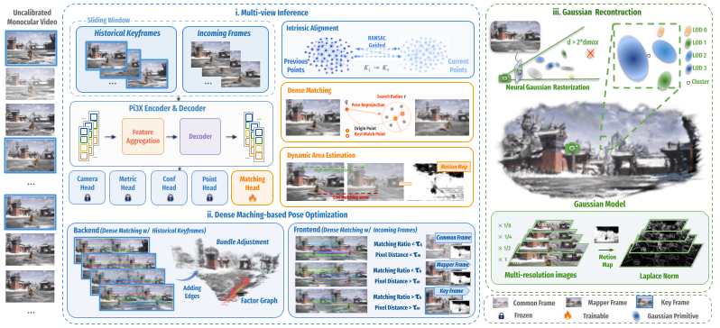

# M³: Dense Matching Meets Multi-View Foundation Models for Monocular Gaussian Splatting SLAM

[](https://city-super.github.io/M3/) [](https://huggingface.co/cskrren/M3) [](https://arxiv.org/abs/2603.16844)

[Kerui Ren](https://scholar.google.com/citations?user=5kW5apkAAAAJ), [Guanghao Li](https://scholar.google.com/citations?user=6nkKQDIAAAAJ), [Changjian Jiang](https://scholar.google.com/citations?user=V4miywEAAAAJ), [Yingxiang Xu](https://github.com/LeoX0808), [Tao Lu](https://scholar.google.com/citations?user=Ch28NiIAAAAJ), [Linning Xu](https://eveneveno.github.io/lnxu/), [Junting Dong](https://jtdong.com/), [Jiangmiao Pang](https://oceanpang.github.io/), [Mulin Yu<sup>†</sup>](https://scholar.google.com/citations?user=w0Od3hQAAAAJ), [Bo Dai<sup>†</sup>](https://daibo.info/)

## 📢 News

**[2026.10.29]** 🚀 Code and Pi3 / Pi3X matching checkpoints are released!

**[2026.09.02]** 🎉 We are happy to announce that M³ has been accepted to **SIGGRAPH Asia 2026**.

## Overview

**Pipeline of M³.** Our framework consists of joint tracking and global optimization for pose estimation and a mapper for scene reconstruction. For monocular sequences, Pi3X processes retrieved historical keyframes and new frames in one inference to facilitate factor graph construction and keyframe selection. Following the Neural Gaussian and LOD architecture of ARTDECO, Gaussians are initialized via Laplacian norm and optimized jointly with camera poses.

This repository contains the **static Gaussian-splatting pipeline** with
Pi3 / Pi3X matching frontends. The default entry point uses **GS with dynamics
disabled**. Experimental triangle mapping and dynamic-layer prototypes are not
part of this release. Checkpoints, datasets, cluster launchers and experiment
outputs are deliberately not included.

## System architecture

1. **Tracking:** process incoming RGB frames together with retrieved reference
   keyframes; predict geometry and dense correspondences with a matching model.
2. **Geometric optimization:** use the correspondence constraints in the SLAM
   backend to estimate camera motion and optimize the factor graph.
3. **Mapping:** initialize and optimize neural Gaussians using multi-resolution
   image information, with view-dependent selection and appearance modeling.
4. **Rendering and evaluation:** export the static scene, camera estimates and
   held-out renders. Keep frontend pose evaluation separate from mapper-refined
   rendering evaluation.

## Installation

### Requirements

- Linux, an NVIDIA CUDA-capable GPU, a CUDA toolkit with `nvcc`, and a C++17 compiler.
- Python 3.11 and a compatible CUDA-enabled PyTorch / torchvision pair.
- Sufficient VRAM for the foundation model and the growing Gaussian map.

The development experiments used an A800 80 GB, Python 3.11,
PyTorch **2.10.0+cu128**, torchvision **0.25.0+cu128**, gsplat **1.5.3**,
torch-scatter **2.1.2**, and PyPose **0.9.5**.

### Environment setup

```bash
git clone https://github.com/InternRobotics/M3.git
cd M3
conda create -n m3 python=3.11
conda activate m3

# Install PyTorch matching your CUDA setup first.
python -m pip install torch==2.10.0 torchvision==0.25.0 \
  --index-url https://download.pytorch.org/whl/cu128
python -m pip install -r requirements.txt
```

If torch-scatter has no wheel matching your PyTorch/CUDA combination, build it
against the installed PyTorch and CUDA toolkit. Do not silently replace it with
an incompatible wheel. GPU compilation can take several minutes.

### Native extensions and auxiliary dependencies

```bash
# Optional: set this to your GPU's compute capability before compilation.
# export TORCH_CUDA_ARCH_LIST=8.0  # A100/A800 example
bash scripts/install_native.sh
```

Use the **bundled** native source for:

- `VSLAM/`: the `mast3r_slam_backends` CUDA extension used by geometric optimization.
- `Reconstruct/submodules/diff-gaussian-rasterization`: optimizer functions
  `adamUpdate` and `adamUpdateBasic`; an arbitrary rasterizer package is not a substitute.
- `Reconstruct/submodules/simple-knn`: the required `distIndex2` entry point.
- `Reconstruct/submodules/fused-ssim`: the fused SSIM loss.

The viewer-related dependencies are currently imported by the application even
with `--viewer_mode none`; EGL/OpenGL runtime libraries may therefore be needed
on headless Linux hosts. On Ubuntu these commonly include `libegl1`, `libgl1`,
`libopengl0`, `libglib2.0-0` and `libxrender1`.

Third-party sources are bundled in this repository. Each component's copyright
headers and license notices are retained.

## Checkpoint preparation

Two different model assets are needed:

| Asset | Expected location / selection |
|---|---|
| Pi3 **matching** checkpoint | User-supplied path with `config/yaml/pi3/pi3match.yaml` |
| Pi3X **matching** checkpoint, as an alternative | User-supplied path with `config/yaml/pi3/pi3xmatch.yaml` |
| SALAD retrieval checkpoint | `checkpoints/dino_salad.ckpt` |

The matching model is not interchangeable with an unmodified base geometry
checkpoint. Loading is strict: mismatched or missing heads fail explicitly.
For `.pt`, the state dictionary is expected under the `model` key; a compatible
`.safetensors` state dictionary is also supported. Load only trusted weights.

The designated matching-weight repository is
[`cskrren/M3`](https://huggingface.co/cskrren/M3) on Hugging Face.
**Pi3.pt (pi32) and Pi3X.pt (pi3x3) are available.**

```bash
mkdir -p checkpoints
wget https://huggingface.co/cskrren/M3/resolve/main/Pi3.pt -O checkpoints/pi3_matching.pt
wget https://huggingface.co/cskrren/M3/resolve/main/Pi3X.pt -O checkpoints/pi3x_matching.pt
```

Use the corresponding Pi3/Pi3X configuration for each checkpoint.
Obtain SALAD assets under the upstream project's applicable terms.

## Quick start

### Input layout

```text
data/my_scene/
├── images/
│   ├── 000000.png
│   ├── 000001.png
│   └── ...
```

### GS with Pi3 matching

```bash
bash run.sh data/my_scene checkpoints/pi3_matching.pt pi3 \
  -m results/my_scene_pi3 (--calib data/my_scene/intr.yaml)
```

### GS with Pi3X matching

```bash
bash run.sh data/my_scene checkpoints/pi3x_matching.pt pi3x \
  -m results/my_scene_pi3x (--calib data/my_scene/intr.yaml)
```

### Outputs

```text
results/my_scene_pi3/
├── slam/frames.txt          # raw frontend SLAM trajectory
├── metadata.json           # online mapper state and metrics
├── point_clouds/           # online Gaussian/point exports
└── <finetune_epoch>/
    ├── metadata.json       # final metrics and mapper-optimized cameras
    ├── point_clouds/
    ├── test_images/
    └── colmap/
```

## Contact and citation

For questions, contact [Kerui Ren](mailto:renkerui@sjtu.edu.cn).
Please cite our paper:

```bibtex
@article{ren2026m,
  title={M\^{} 3: Dense Matching Meets Multi-View Foundation Models for Monocular Gaussian Splatting SLAM},
  author={Ren, Kerui and Li, Guanghao and Jiang, Changjian and Xu, Yingxiang and Lu, Tao and Xu, Linning and Dong, Junting and Pang, Jiangmiao and Yu, Mulin and Dai, Bo},
  journal={arXiv preprint arXiv:2603.16844},
  year={2026}
}
```

